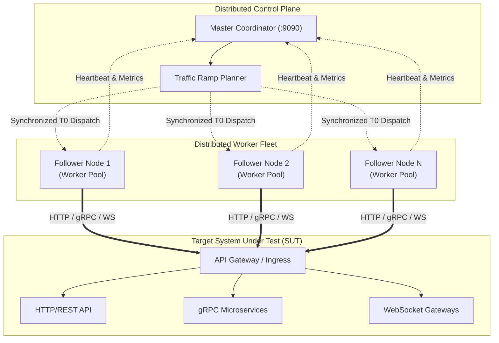

# ⚡ TurboStorm-Load: Distributed Synthetic Traffic Generator & Stress Orchestrator

<p align="center">
  
</p>

<p align="center">
  <a href="https://github.com/ER-brocode/turbostorm-load/actions/workflows/ci.yml">
    
  </a>
  <a href="https://golang.org/">
    
  </a>
  <a href="https://github.com/ER-brocode/turbostorm-load/blob/main/LICENSE">
    
  </a>
  <a href="https://github.com/ER-brocode/turbostorm-load/stargazers">
    
  </a>
</p>

---

## 🚀 Key Highlights

* **Multi-Protocol Engine**: Native high-throughput clients for **HTTP/1.1**, **HTTP/2 multiplexing**, RFC 6455 **WebSocket**, and **gRPC** unary calls.
* **HDR Latency Percentiles**: Microsecond-precision **High Dynamic Range (HDR) Histogram** recording latency metrics from **p50**, **p90**, **p95**, **p99**, **p99.9** up to **p99.99**.
* **Distributed Synchronization**: Clustered master-follower coordination with wall-clock synchronized $T_0$ traffic ramp-ups.
* **Complex Traffic Profiles**: Linear ramps, sinusoidal oscillations, Poisson burst arrivals, and abrupt stress spikes.
* **Zero External Dependencies**: Pure Go standard-library implementation designed for bare-metal performance with zero allocation overhead in inner loops.

---

## 📐 Architecture & Cluster Topology



---

## 📊 Benchmark Latency Report Preview

```text
========================================================================================
                     TURBOSTORM-LOAD PERFORMANCE BENCHMARK REPORT                      
========================================================================================
 Duration:          30.00s
 Total Requests:    300,000
 Successful:        299,985
 Errors:            15 (0.00%)
 Throughput:        10000.00 req/s (42.80 MB/s)
----------------------------------------------------------------------------------------
 LATENCY PERCENTILES (Microseconds & Milliseconds):
   Min:                  210 us  (    0.21 ms)
   Mean:                 840 us  (    0.84 ms)
   p50 (Median):         710 us  (    0.71 ms)
   p90:                 1120 us  (    1.12 ms)
   p95:                 1430 us  (    1.43 ms)
   p99:                 2350 us  (    2.35 ms)
   p99.9:               4890 us  (    4.89 ms)
   p99.99:              9120 us  (    9.12 ms)
   Max:                14250 us  (   14.25 ms)
----------------------------------------------------------------------------------------
 HTTP STATUS DISTRIBUTION:
   [200]: 299,985 requests
   [503]: 15 requests
========================================================================================
```

---

## 🛠️ Quickstart

### 1. Standalone Traffic Generation

```bash
# Build binary
go build -o turbostorm ./cmd/turbostorm

# Run a 30s ramp test up to 10,000 RPS
./turbostorm -mode=standalone \
  -url="http://127.0.0.1:8080/api/v1/resource" \
  -proto=http1 \
  -pattern=ramp \
  -initial-rps=500 \
  -rps=10000 \
  -ramp=10s \
  -duration=30s \
  -c=200
```

### 2. Distributed Cluster Mode

#### Launch Master Coordinator
```bash
./turbostorm -mode=master -listen=":9090"
```

#### Launch Follower Workers
```bash
# Worker 1
./turbostorm -mode=follower -id="node-eu-west-1" -listen=":9091" -master="127.0.0.1:9090"

# Worker 2
./turbostorm -mode=follower -id="node-us-east-1" -listen=":9092" -master="127.0.0.1:9090"
```

---

## 🧪 Automated Testing

TurboStorm Load includes comprehensive automated tests covering:
- **HDR histogram percentile calculations**: Validates mathematical distribution accuracy and dynamic range scaling against standard sorting benchmarks.
- **Traffic ramp curves**: Tests linear ramps, step functions, Poisson arrival calculations, and sinusoid schedules.
- **End-to-end synthetic traffic generation**: Full in-memory client-server loop with connection pooling and metrics verification.

```bash
go test -v -race ./...
```

---

## 📜 License

Apache License 2.0. Copyright (c) 2026 ER-brocode.
